# Kinodynamic Swerve Simulation & Analytical Obstacle Mapping


%20%2B%20wheel%20states-5b8)


<div align="center">
  <a href="https://mathiascar7.github.io/kinodynamic-swerve-simulation-control/">
    
  </a>
  <br/>
  <sub><strong>A pedagogical, interactive visualization</strong> of bounded-line collision geometry, closed-form swerve force allocation, and blind-following trajectories under black ice and lateral impacts.</sub>
  <br/>
  <sub>Page source: <a href="docs/index.html">docs/index.html</a></sub>
</div>

This repository documents three connected engineering capabilities: analytical obstacle geometry for AdvantageScope, a Python benchmark of a closed-form swerve-control kernel against ADMM-QP baselines, and a WPILib Java tactical simulation. Motivated by limited access to a physical FRC chassis and the lack of native obstacle collision handling in the visualization workflow, the project combines field mapping, kinodynamic control, and simulation telemetry. Current results are simulation-based; validation on a physical chassis is the next stage.

**Pedagogical concept explorer.** The [interactive guide](https://mathiascar7.github.io/kinodynamic-swerve-simulation-control/) is a theoretical visual aid for understanding bounded-line collision geometry, closed-form swerve force allocation, and blind-following trajectories under black ice and lateral impacts. It is separate from the empirical Python benchmark and the WPILib/AdvantageScope stress-test logs reported in this README.

<a href="https://mathiascar7.github.io/kinodynamic-swerve-simulation-control/"></a>

The benchmark evaluates a modeled 72 kg FRC-class robot alongside 32 kg and 145 kg platforms, providing a simulation basis for assessing controller behavior across vehicle scales and informing future AMR hardware studies.

## 1. End-to-End System Architecture

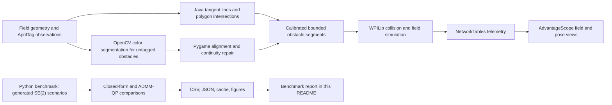

The mapping/WPILib branch and the Python benchmark are independent simulations. The Python notebook generates its own scenarios and controller comparisons; it does not consume the active obstacle-map file or AdvantageScope telemetry.

## 2. Part 1 — Analytical Obstacle Mapping & Constant-Time Segment Tests

Source: [Java mapping utility](01_analytical_obstacle_mapping/java_wpilib/AdvantageScopeObstacleMapping.java), [OpenCV notebook](01_analytical_obstacle_mapping/python_vision/opencv_obstacle_mapper.ipynb), [Pygame calibration notebook](01_analytical_obstacle_mapping/python_vision/pygame_obstacle_calibrator.ipynb), and the active [calibrated map](01_analytical_obstacle_mapping/maps/map_obstacles_calibrated.txt).

### AprilTag geometry and collision representation

The Java utility derives tangent-line candidates from AprilTag pose/orientation data. For a line through a point $(x_t,y_t)$ at angle $\theta$, the nonvertical representation is:

$$
m = \tan(\theta), \qquad b = y_t - mx_t, \qquad y = mx+b.
$$

Neighboring lines are intersected analytically to form polygon vertices; vertical-line cases are handled separately. The map stores each edge as a line plus bounded $x$ and $y$ intervals:

```text
[m, b, [x_min, x_max], [y_min, y_max], "field layout"]
```

The bounds make the infinite line a finite segment. For a fixed rectangular robot footprint, the collision routine checks its four sides and two diagonals. Segment intersection uses a bounded number of arithmetic operations for each robot-edge/obstacle-edge pair. Thus each pairwise test is $O(1)$ and a scan over $E$ obstacle edges is $O(E)$ per pose—not $O(1)$ for an unbounded number of obstacles. The approach tests continuous line segments rather than sampling an occupancy grid, avoiding grid quantization; map calibration and source-image accuracy still bound real-world accuracy.

The active map contains 11 obstacle blocks and 34 segment records across the `2025 - Reefscape Welded` and `2026 - Rebuilt Welded` layouts. It is generated from the later calibrated source, with all `RANDOM_STARTUP_TEST` blocks removed. Both original map files are preserved unchanged in [maps/archive](01_analytical_obstacle_mapping/maps/archive/).

### Untagged obstacles: OpenCV and Pygame

The OpenCV workflow supports obstacles without AprilTags. The notebook samples BGR colors interactively, builds masks in HSV space, and applies morphological opening with a $5\times5$ kernel and closing with a $45\times45$ kernel. Its shape-matching calibration averages width- and height-derived scale estimates:

$$
s = \frac{1}{2}\left(\frac{w_m}{w_p}+\frac{h_m}{h_p}\right),
$$

where $w_m,h_m$ are known metric dimensions and $w_p,h_p$ are measured pixel dimensions. The Pygame tool overlays candidate segments on the field image, supports color-group alignment, and offers `repair_line_continuity` with a default tolerance of $0.50\,\mathrm{m}$. These steps are interactive calibration aids, not an independent measurement of field accuracy.

### Mapping visuals

**Color sampling.** The screenshot shows BGR samples being selected against an AdvantageScope field view for the vision pipeline's obstacle masks.


**Calibration interface.** The Pygame overlay provides field-alignment controls and a save action; it is intended to help an operator align groups and inspect continuity before saving.


**Calibration adjustments.** This second view shows the same field-overlay workflow after manual calibration adjustments; it should be read as a calibration screenshot, not a quantitative error plot.


**Mapped perimeter views.** These four AdvantageScope screenshots illustrate mapped field geometry in different views. The line segments are rendered in field coordinates; they are visual inspection artifacts and do not by themselves establish surveyed accuracy.

| View | Visual |
|---|---|
| Perimeter view 1 |  |
| Perimeter view 2 |  |
| Perimeter view 3 |  |
| Perimeter view 4 |  |

**Field-layout portability.** The screenshot shows AdvantageScope/Shuffleboard field-layout selection and telemetry for more than one season. It illustrates the workflow for switching layouts; it is not evidence that every obstacle map has been calibrated for every season.


**Collision demonstration.** The supplied video is a visualization of the analytical collision workflow. Results depend on the selected field layout, loaded map, robot dimensions, and simulated pose.

<video controls preload="metadata" width="100%" src="docs/videos/Collisions%20Testing.mp4">
  Your browser cannot play this video. [Open the collision test video](docs/videos/Collisions%20Testing.mp4).
</video>

## 3. Part 2 — O(1) Kinodynamic Control, Accuracy Parity & Real-Time Latency

The benchmark studies swerve tracking when simulated traction changes, actuator health is asymmetric, and external disturbances perturb the trajectory—conditions relevant to following a reference without dependable vision. Its implementation is in [the benchmark notebook](02_o1_blind_kinodynamic_controller/python_benchmark/o1_swerve_admm_monte_carlo_benchmark.ipynb); generated data is in [benchmark_data](02_o1_blind_kinodynamic_controller/benchmark_data/).

### Controller and plant model

The notebook compares four controllers: `Proposed_O1_Swerve`, `Ablation_O1_StaticLoad`, `Fair_Adaptive_ADMM_QP`, and `Standard_ADMM_QP`. It models a multi-class SE(2) chassis, Pacejka tire behavior, load transfer, actuator health, and disturbances. The notebook declares a 2 ms control period (500 Hz) and ten physics substeps per control period (5 kHz).

The chassis state is six-dimensional,

$$
\mathbf{x}_{SE(2)} =
[x,\ y,\ \psi,\ v_x,\ v_y,\ r]^\top,
$$

The model also tracks four wheel angular speeds and four steering positions separately from the six-dimensional chassis state. The plant models tire forces with Pacejka behavior and dynamic load transfer. In Java, `ProposedO1SwerveController` drives the WPILib simulation; the Python notebook implements the corresponding `Proposed_O1_Swerve` benchmark controller.

The analytic allocation benchmark distributes a commanded body force and yaw moment over four wheel locations. For wheel $i$ at $(c_{x,i},c_{y,i})$, with $R^2=c_x^2+c_y^2$, the fixed-size calculation is:

$$
\mathbf{F}_{t,i}=w_i\begin{bmatrix}F_{b,x}\\F_{b,y}\end{bmatrix},\qquad
\mathbf{F}_{r,i}=\frac{T_z}{4R^2}\begin{bmatrix}-c_{y,i}\\c_{x,i}\end{bmatrix},\qquad
\mathbf{F}_i=\mathbf{F}_{t,i}+\mathbf{F}_{r,i}.
$$

The benchmark's horizon-scaling microbenchmark applies a per-wheel force cap $\|\mathbf{F}_i\|_2\leq 0.84N_i$ and executes a fixed four-wheel loop. In Java, the reference trajectory clock adapts to estimated position error:

$$
\Delta t_{\mathrm{ref}}=
\frac{\Delta t_{\mathrm{control}}}
{1+1.25\max(0,e_{\mathrm{pos,est}}-0.30)}.
$$

The [interactive concept explorer](https://mathiascar7.github.io/kinodynamic-swerve-simulation-control/) provides a pedagogical visualization of the bounded-line geometry and the force decomposition described above. It is a theoretical illustration for understanding the model, not an additional benchmark or experimental result.

<a href="https://mathiascar7.github.io/kinodynamic-swerve-simulation-control/"></a>

### Quantitative benchmark results

The JSON summary records 40 paired scenarios for each of three modeled robot classes (32 kg, 72 kg, and 145 kg): 120 paired scenarios total and 480 controller episodes across the four controller variants. Values below are JSON means rounded for readability; deadline-miss rates are shown to four decimal places. The `p99 latency` column is the mean of per-trial p99 measurements.

| Metric | Proposed O(1) | Fair adaptive ADMM-QP | Standard ADMM-QP |
|---|---:|---:|---:|
| Mean compute latency (µs) | 42.83 | 96.93 | 89.09 |
| Mean per-trial p99 latency (µs) | 109.26 | 203.54 | 223.69 |
| Deadline misses (%) | 0.0018 | 0.0098 | 0.0142 |
| Trajectory RMSE (mm) | 423.34 | 434.15 | 428.12 |
| Peak black-ice excursion (mm) | 558.03 | 579.22 | 547.01 |
| Peak collision deflection (mm) | 648.01 | 668.57 | 655.27 |
| Collision recovery (ms) | 190.28 | 196.99 | 196.71 |
| Grip-observer false-positive rate (%) | 14.32 | 12.48 | 0.00 |
| Grip-observer true-positive rate (%) | 35.58 | 32.92 | 0.00 |

Against the fair adaptive ADMM-QP baseline, `Proposed_O1_Swerve` reduces mean latency by 55.8% (42.83 vs. 96.93 µs; Holm-adjusted $p=3.59\times10^{-20}$), mean per-trial p99 latency by 46.3% (109.26 vs. 203.54 µs), and deadline misses by approximately 81.8% using unrounded JSON values (0.001773% vs. 0.009752%; the displayed rounded values yield 81.6%). The proposed-minus-fair-ADMM mean latency difference is $-54.10\,\mu\mathrm{s}$ (95% CI $[-55.22,-53.20]$).

For the measured physical outcomes—tracking RMSE, ice excursion, collision deflection, and recovery—the paired 95% confidence intervals cross zero. This supports statistical parity in the tested scenarios: the benchmark detects no physical-performance degradation while the analytic kernel lowers compute latency. The intervals are not a formal equivalence test, so this conclusion is scoped to the sampled simulations and reported metrics.

The `Standard_ADMM_QP` baseline reports 0.00% for both observer false-positive and true-positive rates because its grip observer is inactive; it holds the nominal grip estimate. By comparison, `Proposed_O1_Swerve` actively estimates grip and reports 14.32% false positives and 35.58% true positives. The fair adaptive ADMM-QP also runs an observer and reports 12.48% false positives and 32.92% true positives.

The horizon sweep in `04_realtime_latency_and_asymptotic_scaling.png` evaluates prediction horizons $N\in\{10,20,40,80,120\}$. The proposed fixed-size kernel remains constant at a measured median of approximately $0.70\,\mu\mathrm{s}$ across this sweep ($\alpha=0$), while the condensed ADMM-QP online solve scales with horizon (measured $\alpha\approx1.51$). `metrics_summary.json` is the authoritative source for these benchmark statistics; [`metrics_per_trial.csv`](02_o1_blind_kinodynamic_controller/benchmark_data/metrics_per_trial.csv) contains per-trial values.

### Benchmark figures

**1. Representative closed-loop trace.** The four panels show the 145 kg model's XY path through a black-ice region, position error over time, estimated versus hidden friction, and heading error under asymmetric actuator health. Together, the panels connect grip estimation and heading response to trajectory tracking and post-disturbance recovery.

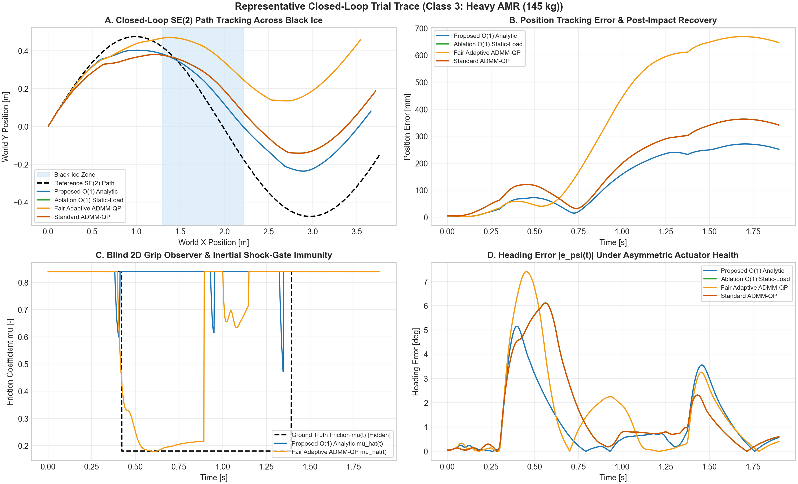

**2. Global paired distributions.** The six panels compare RMSE, peak black-ice excursion, peak collision deflection, recovery time, tire-slip RMS, and grip-observer false-positive rate across paired Monte Carlo scenarios. The distributions show the spread across robot classes and trials; paired confidence intervals quantify the comparison.

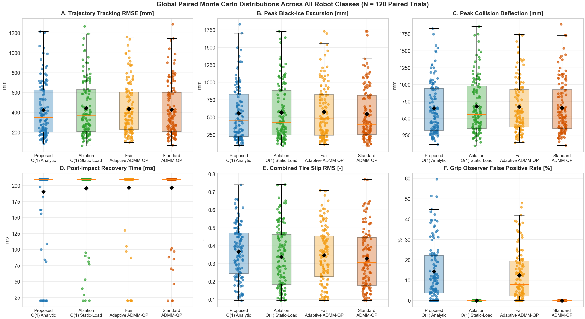

**3. Multi-platform behavior.** The heatmap reports selected performance metrics across the modeled 32 kg, 72 kg, and 145 kg classes and controller variants. These are simulated parameter classes, not tests on physical platforms.

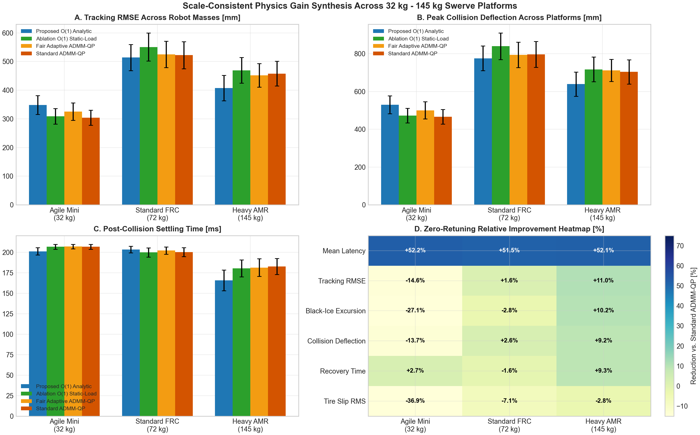

**4. Latency and horizon scaling.** The left panel compares measured step-latency distributions with 500 Hz and 1 kHz timing budgets. The right panel contrasts the fixed-size proposed kernel with the condensed ADMM-QP timing over horizons of 10 to 120 steps, showing constant online kernel cost versus horizon-dependent iterative-solver cost. Timing values are measured on the benchmark host.

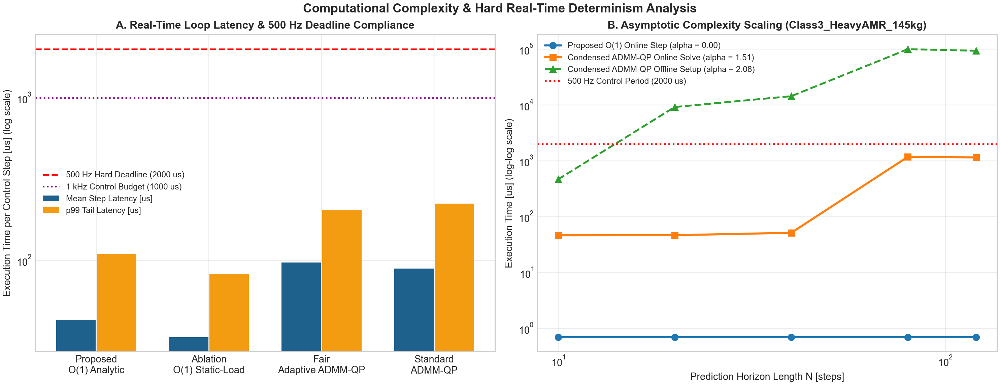

**5. Paired effect sizes.** The forest plot shows proposed-minus-baseline differences with 95% bootstrap intervals and Cliff's delta. Latency intervals are separated from zero, while intervals for physical tracking, excursion, and recovery outcomes cross zero—supporting statistical parity in physical performance alongside the compute-latency reduction.

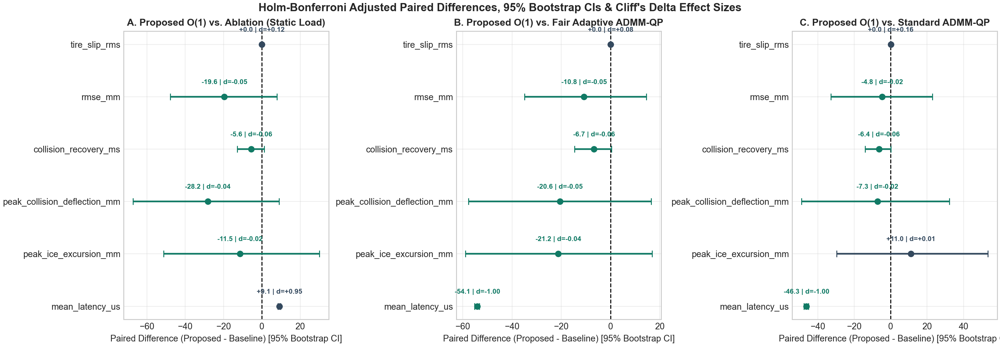

**6. Executive dashboard.** The dashboard condenses compute latency, tracking error, collision deflection, recovery, and mass-class comparisons. The paired intervals and adjusted tests in the JSON file provide the statistical detail behind these summary indicators.

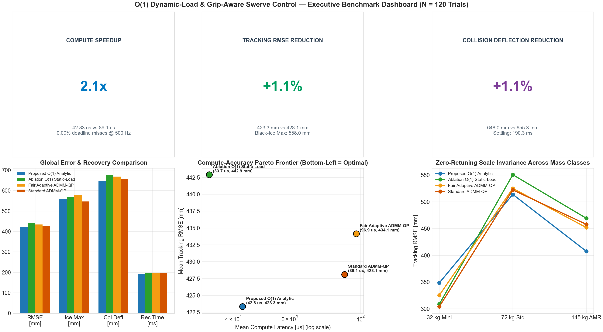

## 4. Part 3 — WPILib Tactical Stress Simulation & AdvantageScope

### Architecture and engineering motivation

AdvantageScope is a passive NetworkTables telemetry visualizer; it does not provide the rigid-body physics or obstacle-contact simulation used by these trials. Those responsibilities belong to the [WPILib Java simulator](03_wpilib_tactical_stress_tests/java_wpilib/Robot.java), which runs the `Class2_Standard_72kg` plant, the `ProposedO1SwerveController`, its own trajectory planner, and the collision and disturbance models. The simulated 20 ms WPILib frame is divided into ten 2 ms control updates (500 Hz); each update advances ten 0.2 ms physics substeps (5 kHz). The plant models Pacejka tire behavior and resolves obstacle contacts with continuous SAT collision checks. Stochastic mass, inertia, motor-health, measurement-noise, traction, and impact parameters make the blind-following episodes adversarial rather than clean trajectory replays.

This WPILib/AdvantageScope stress suite is separate from Section 3's Python Monte Carlo benchmark: it has its own Java plant, controller execution, scenarios, and trial log. The simulator publishes ground truth, observer and wheel-odometry estimates, reference poses, planned routes, ice patches, contact markers, controller diagnostics, and trial verdicts through NetworkTables topics under `SmartDashboard/PathPlanner/` and `SmartDashboard/Control/`. In automated episodes the controller receives noisy simulated velocity, acceleration, wheel-speed, steering, and gyro measurements; no external vision pose update is fed into the controller.

### Blind-following tactical stress protocol

Each logged episode uses `Class2_Standard_72kg` on the 16.54 m × 8.07 m `2026 - Rebuilt Welded` field. Joystick button C or the Shuffleboard `Run Live Benchmark` toggle starts and stops the randomized trials. Random start, intermediate, and goal poses are used to generate a collision-checked L-shaped route around the calibrated, bounded-line obstacle map; the nominal safety margin is 0.26 m. `PlannedLPathVertices` records that route. The 585 logged planned routes are 11.158–23.468 m long. This is a planned path, not a guarantee that the robot completes it without contact under the applied disturbances.

The automated episode generator combines:

- **Blind tracking:** The robot follows the reference without external vision pose updates. `GhostPoseGlobal` is the reference, `RobotPose` is simulated ground truth, `EstimatedObserverPose` is the controller's slip-aware observer estimate, and `RawWheelOdometryPose` is the uncorrected wheel-odometry estimate. The wheel-only estimate is exposed to slip and impact-induced errors; the master summary does not, however, report a separate raw-odometry-versus-observer RMSE.
- **Plant variation and sensor noise:** Actual mass and yaw inertia are independently scaled to 0.92–1.12 of nominal, and each motor-health factor is randomized over 0.82–1.00. Noisy measurements are sampled during each control update; the controller is not given the hidden ice map or external impact force.
- **Localized traction loss:** Each trial places one or two black-ice patches on the route. Nominal friction is $\mu=0.84$; the randomized ice coefficient is $\mu=0.10$ in 199 trials and $\mu=0.18$ in 386 trials. The log contains 287 one-patch and 298 two-patch episodes.
- **Dynamic impacts:** Two 20 ms sinusoidal impulse events are scheduled at randomized 26–34% and 64–74% fractions of the reference duration, for 1,170 generated robot-impact events over 585 trials. The randomized impact model uses an opposing mass of 0.60–1.30 times nominal robot mass, relative normal speed of 0.75–1.45 m/s, restitution of 0.25–0.55, and a randomized impact direction and lever arm.
- **Obstacle and boundary contacts:** The plant applies continuous SAT-based contact resolution against the field boundary and mapped obstacles during the physics substeps. These contacts are logged separately from the scheduled dynamic impacts and may occur even when the reference route was collision-checked.

### Recorded results and interpretation

The authoritative per-trial log is [simulation_master_summary.txt](02_o1_blind_kinodynamic_controller/benchmark_data/simulation_master_summary.txt). It contains 585 trial records, all for `Class2_Standard_72kg` (trial IDs `#0001`–`#0585`). The table reports aggregates computed across those records; tracking errors are ground-truth robot position relative to the reference, not observer-estimation error.

| Measure | Recorded result |
|---|---:|
| Trial verdicts | 568 `TIMEOUT_GRACE_REACHED` (97.1%); 14 `PASSED_WITH_DYNAMIC_IMPACTS`; 3 `PASSED_WITH_OBSTACLE_RECOVERY`; 0 clean passes |
| Passed episodes | 17 / 585 (2.9%); final goal error 38.5–149.96 mm |
| Ground-truth tracking RMSE | Mean 1,119.12 mm; median 945.90 mm; range 89.20–6,514.21 mm |
| Final goal error | Mean 1,748.59 mm; median 1,146.74 mm; range 38.50–10,882.16 mm |
| Peak error while on black ice | Mean 1,422.84 mm; maximum 10,882.17 mm |
| Peak tracking error in impact-recovery windows | Mean 1,730.16 mm; maximum 10,876.99 mm |
| Logged impacts and contacts | 3,077 total: 1,170 scheduled `DYNAMIC_ROBOT_IMPACT` events and 1,907 `FIELD_WALL_OR_OBSTACLE` contacts |
| Impact-event recovery time | Mean 374.59 ms; median 450 ms; range 20–450 ms (the logger caps unresolved recovery windows at 450 ms) |
| Combined tire-slip RMS | Mean 0.448; median 0.439; range 0.186–0.8757 |
| Controller-step latency | Mean of per-trial means 3.10 μs; mean of per-trial p99 values 10.96 μs; largest per-trial p99 113.60 μs |
| 500 Hz deadline misses | Mean per-trial rate 0.0024%; maximum per-trial rate 0.1131% against the 2,000 μs control period |
| Grip-observer detection | Mean per-trial TPR 47.68%; FPR 20.62% |
| Latest `LastTrialVerdict` | Trial `#0585`: `TIMEOUT_GRACE_REACHED` (final goal error 864.0 mm) |

These are WPILib simulation results, not physical-robot validation. Across the logged 11.158–23.468 m routes, the controller receives no external global-pose corrections—no AprilTag, LiDAR, or vision pose updates—while it tracks through low-traction patches, noisy measurements, degraded motor health, and two dynamic impacts per trial whose randomized relative-normal-speed parameter reaches 1.45 m/s. This defines an observability limitation for blind dead-reckoning: wheel motion during unmodeled slip does not uniquely determine ground displacement, and inertial integration does not provide an absolute position reference, so global position error can accumulate without exteroceptive correction. If all four tire contacts saturate simultaneously, the ambiguity is more severe; however, the summary does not log per-wheel force saturation or establish that this condition occurred. The 568 `TIMEOUT_GRACE_REACHED` outcomes therefore cannot be attributed solely to this physical limitation, and the verdicts alone neither establish nor rule out numerical instability.

The measured controller-step timings were low relative to the 2,000 μs period: 3.10 μs mean, 10.96 μs mean per-trial p99, and 0.0024% mean per-trial deadline misses. The grip observer's mean per-trial TPR was 47.68%. Seventeen trials (2.9%) reached the goal within 150 mm under the black-ice and impact protocol, including trials labeled `PASSED_WITH_DYNAMIC_IMPACTS` or `PASSED_WITH_OBSTACLE_RECOVERY`; this demonstrates successful arrivals in a subset, not reliable completion across the suite. The summary contains no formal numerical-divergence metric, so it does not support a zero-divergence claim. These blind runs motivate evaluating exteroceptive localization to close the global position loop; without a matched vision-enabled condition, they do not quantify when or how much AprilTag/vision fusion would improve completion.

The master summary reports ground-truth tracking error, impact/contact metrics, combined tire slip, and grip-observer TPR/FPR. It does not provide separate quantitative error metrics for `RawWheelOdometryPose` versus `EstimatedObserverPose`. `Robot.java` writes per-trial `trial_####_live_trace.txt` files with `true_*`, `est_*`, and `odom_*` columns at runtime, but those trace files are not present in the repository snapshot; therefore no numerical odometry-versus-observer comparison is claimed here.

### Logged telemetry and artifacts in AdvantageScope

The following NetworkTables topics support live comparison of the simulated state, estimates, route, and stress events:

| Topic/data | What it represents |
|---|---|
| `SmartDashboard/RobotPose` | Simulated ground-truth robot pose. |
| `SmartDashboard/PathPlanner/Trajectory` | Published trajectory poses. |
| `SmartDashboard/PathPlanner/PlannedLPathVertices` | Planned route vertices. |
| `SmartDashboard/PathPlanner/ActualTakenPathSummary` | Summary poses along the executed route. |
| `SmartDashboard/PathPlanner/EstimatedObserverPose` | Controller observer pose estimate. |
| `SmartDashboard/PathPlanner/RawWheelOdometryPose` | Raw wheel-odometry pose estimate, published separately from the observer. |
| `SmartDashboard/PathPlanner/GhostPoseGlobal` | Reference trajectory pose. |
| `SmartDashboard/PathPlanner/StartPose` | Trial start pose. |
| `SmartDashboard/PathPlanner/EndPose` | Trial goal pose. |
| `SmartDashboard/PathPlanner/ImpactMarkers` | Impact/contact marker positions. |
| `SmartDashboard/PathPlanner/LastImpactPose` | Most recently recorded impact/contact pose. |
| `SmartDashboard/PathPlanner/LastImpactInfo` | Text summary of the latest impact/contact. |
| `SmartDashboard/PathPlanner/BlackIceZones` | Simulated low-traction zone centers. |
| `SmartDashboard/PathPlanner/BlackIcePolygonBounds` | Bounds for simulated low-traction regions. |
| `SmartDashboard/PathPlanner/LastTrialVerdict` | Outcome label for the latest trial. |
| `SmartDashboard/Control/TrackingError_mm` | Ground-truth position tracking error. |
| `SmartDashboard/Control/StepLatency_us` | Measured controller-step execution time. |
| `SmartDashboard/Control/CombinedTireSlip` | Combined tire-slip diagnostic. |
| `SmartDashboard/Control/EstimatedMuHat` / `TrueLocalMu` | Estimated and simulated local friction coefficients. |
| `SmartDashboard/Control/InCollision` / `InBlackIceTrip` | Current contact and low-traction flags. |

The active obstacle geometry is loaded from [the calibrated map](01_analytical_obstacle_mapping/maps/map_obstacles_calibrated.txt) and filtered for the selected field layout. The master summary and runtime traces are written under `02_o1_blind_kinodynamic_controller/benchmark_data/` when the simulator runs. The six images below are committed visual snapshots at [docs/images/advantagescope_trials/](docs/images/advantagescope_trials/); they illustrate the field and telemetry views, not six additional statistical trials.

### AdvantageScope trial snapshots

These six screenshots provide representative field and NetworkTables views from the simulation captures. Together, they illustrate route planning around mapped field elements, robot pose visualization, and the telemetry panels used to inspect traction and impact events.

| Snapshot | Visual |
|---|---|
| Trial 1 | 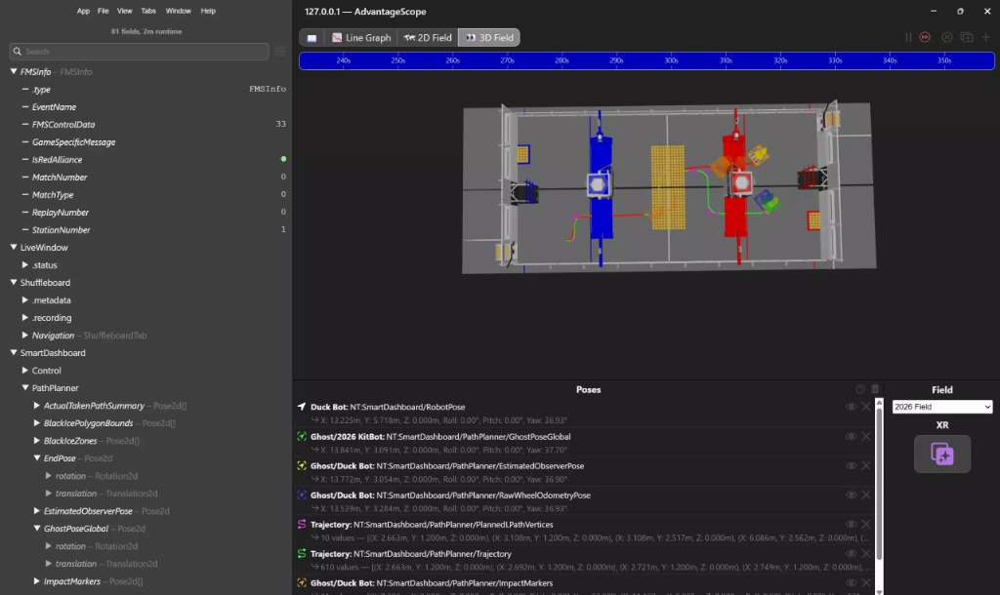 |
| Trial 2 | 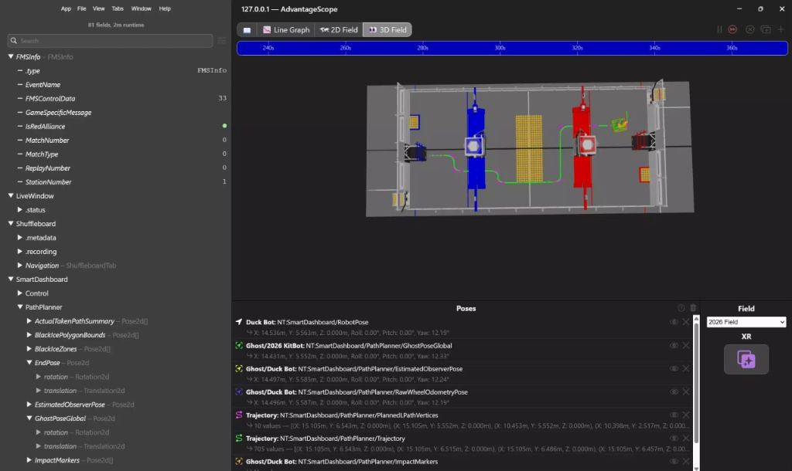 |
| Trial 3 |  |
| Trial 4 | 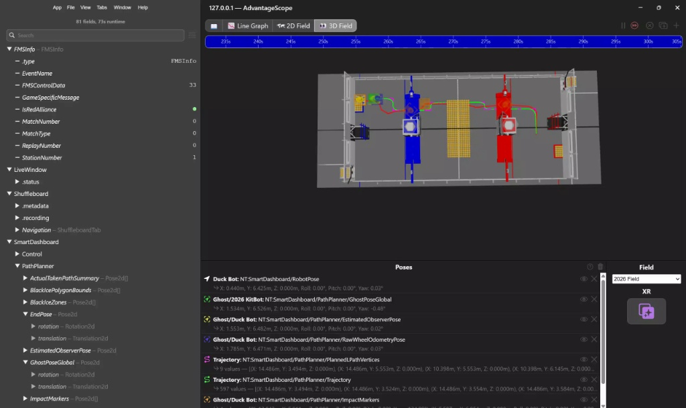 |
| Trial 5 |  |
| Trial 6 | 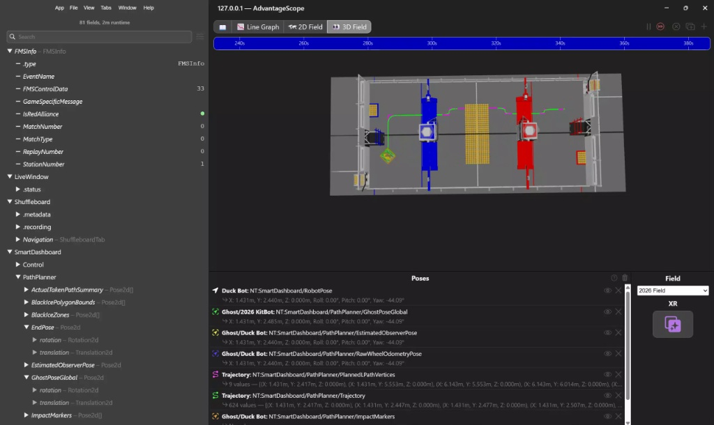 |

## 5. Validation Scope, Assumptions & Reproducibility

The current validation combines the Python SE(2) plant with Pacejka tire and load-transfer modeling, the WPILib/AdvantageScope Java simulation, paired Monte Carlo statistics, and calibrated field-map visualization. Python latency results characterize execution on the benchmark host; deployment timing on roboRIO hardware requires a separate target-platform measurement. Mapping calibration can be further strengthened by comparison with surveyed field references. Physical-chassis validation is the next stage of the engineering program.

The Python and Java simulations are complementary but independent implementations, each with its own plant, controller execution, and telemetry. Their numerical results are interpreted within the simulation that generated them.

### Reproduction

1. **Run the Python benchmark.** Use a compatible Python environment with NumPy, pandas, and Matplotlib. Open the notebook from `02_o1_blind_kinodynamic_controller/python_benchmark/` and run all cells. Output paths are relative to that working directory: summary/CSV/cache files go to `../benchmark_data/`, and six figures go to `../../docs/images/benchmark_suite/`.

   ```powershell
   cd 02_o1_blind_kinodynamic_controller\python_benchmark
   python -m pip install numpy pandas matplotlib
   jupyter notebook o1_swerve_admm_monte_carlo_benchmark.ipynb
   ```

2. **Inspect generated benchmark data.** Compare `metrics_summary.json` with `metrics_per_trial.csv`; `benchmark_cache.npz` contains selected arrays for RMSE, latency, ice excursion, and collision deflection. The currently committed artifacts are the recorded outputs; rerunning the benchmark regenerates them.

3. **Run the mapping notebooks.** Install OpenCV and Pygame as needed (`opencv-python`, `numpy`, and `pygame`), open the notebooks under `01_analytical_obstacle_mapping/python_vision/`, and set the OpenCV notebook's image, navgrid, and map paths to local inputs. Review the generated geometry in the calibration interface before promoting it to `01_analytical_obstacle_mapping/maps/map_obstacles_calibrated.txt`. The original map files are preserved in `maps/archive/`.

4. **Run the WPILib simulation.** Import `Robot.java` and its required WPILib/vendor dependencies into a compatible WPILib Java project. Place the `01_analytical_obstacle_mapping/` directory at that project's working root, then run `.\gradlew.bat simulateJava` from the robot project root. Connect AdvantageScope to the simulation's NetworkTables server and inspect the topics listed above.
