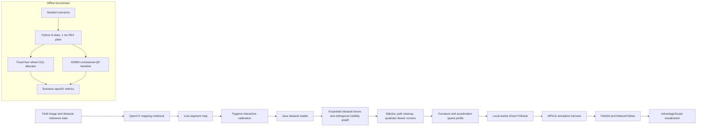

# Kinodynamic Swerve Simulation and Control

This project combines vision-based obstacle mapping, orthogonal visibility-graph planning, curvature-constrained trajectory profiling, a stopping-point-aware follower in local \(SE(2)\), and a fixed-four-wheel \(O(1)\) force allocator with causal impact filtering. Java/WPILib simulation provides route execution and AdvantageScope telemetry; a Python RK4 benchmark evaluates force allocation.

> **Validation scope:** Numerical performance results in this README are outputs from the Python 8-state RK4 benchmark. Route generation, scripted impact injection, and telemetry visualization use the separate Java/WPILib simulation and AdvantageScope. The repository contains simulation results, not physical-chassis measurements.

## 1. Engineering problem

The implementation addresses four development constraints:

1. **Limited access to the physical robot.** Mapping, route generation, impact response, and collision handling need repeatable simulation exercises before hardware deployment.
2. **Ambiguous disturbance signals.** A single-wheel traction-loss event can resemble an external disturbance in a torque/current-derived signal. A temporal-consistency rule compares estimated onset times across wheel modules to distinguish common-mode impacts from isolated wheel events.
3. **Allocation cost and actuator limits.** A convergence-based QP allocator has a data-dependent iteration count. The fixed-four-wheel allocation routine uses bounded per-wheel operations while respecting the benchmark's motor-voltage, current, and friction limits.
4. **Map geometry errors.** Pixel contours and coordinate conversion can yield offset or fragmented obstacle boundaries. The mapping and interactive calibration tools support visual review and limited repair before the geometry is consumed by collision and planning code.

## 2. Architecture and implemented methods



### Module A — Vision mapping and interactive geometry calibration

`Python opencv obstacle mapping.ipynb` uses mouse-selected BGR color samples to segment obstacles. It crops the field using an HSV threshold for the bright field boundary, applies a 5 × 5 morphological opening and 45 × 45 closing to the sampled-color mask, filters small contours, and approximates the remaining contours as polygons. A selected reference obstacle is matched to obstacle records using geometric proportions. If symmetric candidates remain, the operator can select the alliance side (`B` or `R`).

For reference width and height in meters \(w_m,h_m\), and detected pixel dimensions \(w_p,h_p\), the notebook uses the uniform scale

$$
s = \frac{1}{2}\left(\frac{w_m}{w_p}+\frac{h_m}{h_p}\right)
\quad [\mathrm{m/pixel}].
$$

It maps the cropped image coordinates to meters as \(x_m=sx_p\) and \(y_m=s(H_p-y_p)\), reversing the image's vertical axis. Each polygon edge is written as a line-segment record. The notebook clones the selected input map to `map_obstacles_2.txt` before appending mapped segments; inspect this file before using it.

#### Interactive final calibration

`Obstacle final calibration code.ipynb` provides a separate Pygame pass for residual group offsets and small gaps between mapped line fragments:

- A click samples nearby pixels of similar color (within a 90-pixel neighborhood). The tool finds the nearest mapped segment, identifies its obstacle group, compares the sampled-color centroid with the rendered group center, converts that pixel delta to meters using the detected image bounds and 16.54 m × 8.07 m field dimensions, and translates the group's segment coordinates.
- The offset estimate uses a raster color centroid and is applied as a floating-point translation in field coordinates.
- Press **R** to run `repair_line_continuity`. It considers horizontal and vertical segments within the same group and adjusts nearby perpendicular or collinear endpoints using a 0.50 m tolerance. Press **S** or click **SAVE [S]** to write the result. The tool normally creates a sibling file ending in `_calibrated.txt`; if it cannot create that copy, it uses the selected input file.


The calibration and mapping stages are illustrated below.


### Module B — Geometric route planning and kinematic profiling (Java/WPILib)

`Kinematic Tester.java` loads grouped line records and obstacle bounds, then plans between waypoints:

1. **Obstacle expansion and route graph.** Each obstacle box is expanded by half the robot's diagonal, \(\sqrt{L_r^2+W_r^2}/2\), plus the configured safety margin. Candidate x/y coordinates around expanded boxes form an orthogonal visibility graph. Adjacent nodes on each row or column are connected only when the segment is obstacle-free. Dijkstra's algorithm returns the shortest graph path; its Java priority queue retains duplicate entries, giving a search cost of \(O(V+E\log E)\).
2. **Path cleanup and corner smoothing.** Duplicate nodes are removed. A micro-step shorter than 0.18 m is removed only when the direct replacement segment is clear; segment-versus-box visibility uses Liang–Barsky clipping. Turns are trimmed and sampled as quadratic Bézier curves (10 subdivisions per curve, with the trim distance capped at 0.55 m).
3. **Speed and heading profile.** `perfilamientoFisicoON` runs in \(O(N)\) over the sampled path. It applies a 2.8 m/s speed cap, a 4.0 m/s² acceleration/deceleration forward-backward pass, and a discrete curvature limit \(\sqrt{0.95g/\kappa}\) when \(\kappa>0.1\ \mathrm{m}^{-1}\). Heading follows the shortest angular change linearly with cumulative path distance. The resulting poses receive a robot-footprint collision check.

### Module C — Local-inertia follower and impact/slip logic

The Java `LocalInertiaGhostFollower` estimates a stopping point from the previous commanded velocity, using \(x_{\mathrm{stop}}=x+v_x|v_x|/(2a_{\max})\) and the corresponding expression for \(y\), with \(a_{\max}=9\ \mathrm{m/s^2}\) (and a separate angular limit). It compares this point with the current reference sample. As stopping-point error \(e\) grows, the reference clock factor \(\max(0,1-1.5\|e\|)\) slows reference-time advancement and the tangent feedforward factor \(1/(1+2.5\|e\|)\) lowers commanded motion. Reducing the reference demand while the stopping point lags gives the actuator commands time to recover and reduces saturation pressure. Position feedback and heading control continue to track the reference. `GhostPose` and `StoppingPoint` are published for visualization.

The Python benchmark implements a distinct fixed-four-wheel force allocator. It distributes planar force according to \(w_i=N_i/\sum_k N_k\), projects each wheel force onto \(\|\mathbf{F}_i\|_2\leq\mu N_i\), and applies a motor limit based on bus voltage, back-EMF, and a 120 A current ceiling. For a fixed four-wheel platform its loops have a fixed number of iterations and do not iterate to solver convergence.

The benchmark's causal filter retro-projects a torque-change time:

$$
t_{0,i}=t-\frac{|\tau_i|}{|d\tau_i/dt|}.
$$

It flags an event when at least three modules are active and the standard deviation of the four projected times is at most 0.8 ms. The benchmark's activity threshold is \(|d\tau_i/dt|>80\ \mathrm{N\,m/s}\); inactive modules are assigned the current time.

The Java simulation contains a separate simplified filter: its derivative threshold is 120, and a detected event adjusts only the forward command, capped at ±0.8 m/s. It does not run the Python force-allocation routine.

## 3. Simulation and benchmark results

### Python 8-state RK4 benchmark

The Monte Carlo notebook uses

$$
\mathbf{x}=[x,\ y,\ v_x,\ v_y,\ \omega_{w,0},\ \omega_{w,1},\ \omega_{w,2},\ \omega_{w,3}]
$$

with a 1 ms step and classical fourth-order Runge–Kutta integration. The chassis translation includes viscous damping \(-b\mathbf{v}\), with \(b=35\ \mathrm{N\,s/m}\). The actuator model limits current to 120 A and reduces available torque with back-EMF. The benchmark also introduces a one-step force-command transmission delay.

Each 3.5 s trial uses a 70 kg nominal mass varied uniformly by ±5%, a 320–380 N impact at 85–95 degrees from 1.80–1.83 s, and a front-left-wheel slip interval from 0.80–0.85 s. The torque signal includes 0.15 N·m Gaussian noise. A fixed NumPy random seed (`42`) makes the scenario sequence deterministic.

The saved notebook output for \(N=50\) trials is:

| Metric as evaluated by the notebook | Fixed-four-wheel O(1) | ADMM constrained-QP |
|---|---:|---:|
| Mean allocation latency (µs) | 41.11 ± 1.25 | 20.17 ± 0.57 |
| Maximum \(|y|\) in impact window, 1.80–2.10 s (mm) | 33.19 ± 0.46 | 40.90 ± 0.22 |
| Full-trial lateral \(y\) RMSE over 3.5 s (mm) | 18.22 ± 0.23 | 27.96 ± 0.08 |
| Slip-window false-positive rate (%) | 10.64 ± 1.21 | 100.00 ± 0.00 |

In these trials, the O(1) implementation reports 18.8% lower peak lateral drift and 34.8% lower lateral RMSE than the QP baseline, while its slip-window false-positive rate is 89.36 percentage points lower.


### Java/WPILib route and impact simulation

The Java `Kinematic Tester` runs route generation and tracking in WPILib's `simulationPeriodic` loop. The elapsed step is taken from FPGA time, with a 20 ms fallback for invalid intervals. Its command-plus-disturbance model applies an exponentially decaying disturbance and integrates it into the simulated pose.

Raw joystick button **3** (`C`) toggles randomized routes. The code samples start/end poses with randomized headings, attempts route planning, and injects three external impacts at approximately 15%, 50%, and 80% route progress. During an injected impact, the simulation routes the update through the external-disturbance path rather than the wall-collision stop branch. Telemetry includes the robot pose, estimated poses, trajectory, `GhostPose`, `StoppingPoint`, and impact markers.


#### Kinematic Tester video

<video controls preload="metadata" width="100%" src="./Kinematic%20Tester%20Video.mp4">
  Your browser does not support embedded video. [Open the Kinematic Tester video](Kinematic%20Tester%20Video.mp4).
</video>

[Open the Kinematic Tester video](Kinematic%20Tester%20Video.mp4)

#### Collision and impact testing video

<video controls preload="metadata" width="100%" src="./Collisions%20Testing.mp4">
  Your browser does not support embedded video. [Open the collision testing video](Collisions%20Testing.mp4).
</video>

[Open the collision testing video](Collisions%20Testing.mp4)

## Repository structure and reproducibility

### Repository contents

| File | Purpose |
|---|---|
| `Python opencv obstacle mapping.ipynb` | OpenCV field cropping, sampled-color contour mapping, scale calibration, and line-segment export. |
| `Obstacle final calibration code.ipynb` | Pygame group-offset alignment and optional continuity repair. |
| `Deterministic O(1) Kinodynamic Force Allocation.ipynb` | Python RK4 model, O(1) allocation, ADMM baseline, Monte Carlo run, plots, and saved results. |
| `Kinematic Tester.java` | WPILib route planning, local follower, simplified impact simulation, collision checks, and telemetry. Integrate/rename as `Robot.java` in a compatible host project. |
| `Advantage Scope Obstacle Mapping.java` | Additional Java field/obstacle mapping source. |
| `map_obstacles_calibrated.txt` and `map_obstacles_calibrated_calibrated.txt` | Example obstacle-map records. Review map paths and field labels before use. |
| `Mapping Vision part 1.png`–`Mapping Vision part 3.png` | Mapping workflow figures. |
| `FRC Rebuilt Obstacle map perimeter # 1.png`–`# 4.png` | Rendered perimeter examples. |
| `Obstacle Calibration GUI.png` | Interactive calibration screenshot. |
| `Monte Carlo validation Part 1.png`, `Monte Carlo Validation Part 2.png` | Saved benchmark output and plots. |
| `Different Field.png` | Field/telemetry visualization. |
| `Kinematic Tester Video.mp4`, `Collisions Testing.mp4` | Simulation recordings. |

### Reproducible setup

#### Python notebooks

From the project directory, install the notebook dependencies:

```bash
python -m pip install jupyter opencv-python numpy pygame pandas matplotlib
jupyter notebook
```

`tqdm` is optional; the benchmark notebook includes a fallback progress display.

1. Open `Python opencv obstacle mapping.ipynb`. Update its Windows input paths near the final cell (`img_path`, `nav_path`, and `txt_path`). Select obstacle colors, press **P**, select a reference obstacle and press **P** again, resolve an ambiguous alliance match with **B** or **R**, then select further obstacles and press **P** to map them. Press **Esc** when finished. Review `map_obstacles_2.txt`.
2. Open `Obstacle final calibration code.ipynb` and run its cell. Select the image folder and obstacle text file in the GUI, check the competition year and image name settings in the source/configuration, then load the map. Click obstacle groups to align them; press **R** only when a continuity repair is appropriate, then press **S** and inspect the saved file. Back up the input map before calibration, because the tool can fall back to writing to it if it cannot create the calibrated copy.
3. Run all cells in `Deterministic O(1) Kinodynamic Force Allocation.ipynb` to reproduce the 50-trial benchmark and plots.

#### WPILib and AdvantageScope

Integrate the Java source into a host WPILib/GradleRIO project under `frc.robot` (the public `Robot` class must be in `Robot.java`), configure the obstacle path in `DEFAULT_OBSTACLES_PATH`, and use the host project's Gradle wrapper to launch its simulation:

```powershell
.\gradlew.bat simulateJava
```

Connect AdvantageScope to the NetworkTables instance configured by the host project to view the field and telemetry.

## 4. Validation Scope and Modeling Assumptions

The Python Monte Carlo benchmark and Java/WPILib `Kinematic Tester` are separate simulation paths. The table reports Python benchmark output; the Java program exercises map-based route planning, follower behavior, collision logic, and scripted disturbance telemetry. The Java path/impact exercise does not produce the Python benchmark's performance metrics.

### Plant and sensing assumptions

- The Python state \([x,y,v_x,v_y,\omega_{w,0},\omega_{w,1},\omega_{w,2},\omega_{w,3}]\) covers planar translation and four wheel angular speeds; chassis heading/yaw is outside this plant's state. The model uses a 1 ms RK4 step, viscous damping, a 120 A current ceiling, a back-EMF voltage limit, and a one-step force-command delay.
- The causal filter receives synthetic torque values with Gaussian noise and a modeled single-wheel torque drop during slip. Physical motor-current, Back-EMF, and acoustic sensing, as well as a conventional DOB comparison, are outside the notebook evaluation.
- The route profile uses a fixed source constant \(0.95\) in \(\sqrt{0.95g/\kappa}\); tire friction is not estimated online.
- The Pygame offset is estimated from raster color samples and applied to floating-point field coordinates, with spatial information sampled at image-pixel resolution. Continuity repair acts locally on horizontal/vertical fragments within 0.50 m, leaves diagonal segments and larger gaps unchanged, and does not enforce polygon closure.
- The Ghost Follower's stopping-point and reference-clock logic is a feedback heuristic; formal stability analysis is outside the implementation.
- The Java impact sequence is scripted in WPILib simulation and exercises the simulated disturbance and collision-handling paths. Physical-chassis impact-response data is not part of this repository.

### Metric and timing interpretation

- The benchmark's saved \(N=50\) results report mean ± a normal-approximation 95% confidence interval, calculated as \(1.96s/\sqrt{N}\). The notebook labels its third metric “Full Trajectory RMSE” and computes \(\sqrt{\mathrm{mean}(y^2)}\) over 3.5 s, the one-axis lateral-position RMSE. Peak impact drift is maximum \(|y|\) from 1.80–2.10 s.
- Slip false-positive definitions differ between methods: the O(1) result counts causal-filter triggers, while the QP result counts a lateral allocated-force condition above 20 N. The comparison describes the specified synthetic scenario.
- The O(1) Python routine's measured mean latency is higher than the QP baseline. Its per-wheel work uses Python-level loops over four modules; the baseline uses a pre-factored small matrix and NumPy operations, with up to 40 ADMM iterations and an early residual stop. For this implementation, NumPy's matrix operations yield a lower measured mean despite the iterative method. The reported averages are 41.11 µs and 20.17 µs, respectively, both below a 1 ms period (about 24× and 50×). These are host-dependent Python averages; worst-case execution time is unmeasured.
- O(1) describes the allocator for a fixed four-wheel platform. It does not describe the graph-search complexity; the route planner uses Dijkstra's algorithm as detailed above.
